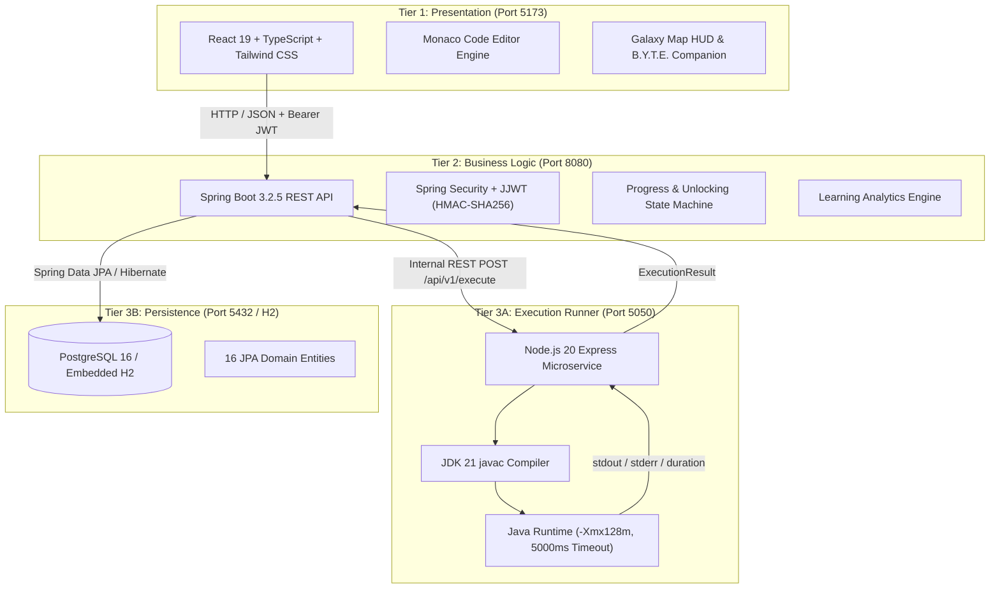

# CodeVoyage — A Gamified Java 21 Learning Platform

> An immersive, space-adventure gamified learning platform where students master authentic Java programming through interactive lessons, real-time sandboxed compilation, automated unit-test grading, and celestial sector progression.

---

## 🚀 Overview

Introductory programming education in computer science often suffers from high attrition rates due to cognitive overload, cryptic compiler feedback, and local toolchain setup friction. Beginners are frequently overwhelmed by ceremonial syntax (`public static void main`, classes, types, imports) before experiencing the creative empowerment of problem-solving.

**CodeVoyage** transforms introductory Java (JDK 21) education into an interstellar expedition. Students assume the role of **Starfleet Cadets** navigating celestial hazard zones. Every mission corresponds to an operational ship crisis—stabilizing plasma reactors, parsing sensor telemetry, or calibrating orbital thrusters—resolved strictly by writing, compiling, and running real Java code in an embedded browser IDE.

### The Central Learning Loop

```
MISSION BRIEFING ➔ STORY CONTEXT ➔ CONCEPT LESSON ➔ INTERACTIVE PRACTICE
       ▲                                                          │
       │                                                          ▼
CLEARANCE & ADVANCE ➔ XP & STARS ➔ AUTOMATED TEST GRADING ➔ JAVA CODE RUN
```

1. **Mission Briefing & Lore**: Cadets encounter a real-time starship emergency on a celestial world.
2. **Concept Lesson**: The target Java concept is explained through visual diagrams and code breakdowns.
3. **Interactive Practice**: Diagnostic quizzes and code prediction drills reinforce comprehension.
4. **Hands-On Coding Challenge**: Cadets write authentic Java in Microsoft's **Monaco Code Editor**.
5. **Sandboxed Compilation & Run**: An isolated runner compiles with `javac` and executes with `java -Xmx128m` under a strict 5000 ms timeout.
6. **Automated Evaluation**: Outputs are checked against visible and hidden unit test cases.
7. **B.Y.T.E. Companion Feedback**: A contextual holographic robot translates compiler errors into friendly plain-English advice.
8. **Flight Clearance & Progression**: Cadets earn experience points (XP), receive 1–3 non-punishing stars, unlock Starfleet achievements, and advance sequentially to the next sector.

---

## 🌟 Key Features

### 1. Authentic Java 21 Coding & Execution
- **Embedded Monaco Editor**: Full syntax highlighting, autocomplete, bracket matching, line numbers, and keyboard shortcuts (`Ctrl+Enter` to run).
- **Multi-Process Sandbox**: Untrusted student code is isolated in ephemeral operating system directories with rigid resource limits (128 MB RAM, 5000 ms timeout).
- **Cryptic Error Translation**: `DiagnosticParser.java` intercepts compiler stack traces (unclosed strings, missing semicolons, type mismatches) and provides plain-English guidance.

### 2. Comprehensive 20-Mission Curriculum Across 4 Worlds
- **World 1 — Ignis Station (Foundations & I/O)**: Java program structure, `int`/`double` variables, `Scanner` standard input, arithmetic operators, and conditional branching (`if`/`else`).
- **World 2 — Kryon Belt (Relational Logic & Multi-Way Decisions)**: Relational operators, boolean logic (`&&`, `||`, `!`), `switch-case` dispatching, and nested logic control.
- **World 3 — Nova Sector (Loops & Iteration)**: `while` loops, `for` loops, `do-while` cycles, flow control (`break`/`continue`), and a 2D matrix scan Boss mission.
- **World 4 — Function Nebula (Methods & Data Structures)**: Static void methods, typed return values, 1D array allocation & indexing, linear search peak detection, and a modular capstone Boss mission.

### 3. Gamification & Progression Engine
- **Galaxy Map**: Interactive orbital sector map with sequential prerequisite unlock chains.
- **Non-Punishing 1–3 Star Rubric**:
  - `★★★`: Challenge cleared with $\le 3$ attempts and zero hints.
  - `★★☆`: Challenge cleared using minor guidance (1 hint).
  - `★☆☆`: Challenge cleared with multiple hints.
- **Rank Titles**: Dynamic cadet rank progression from *Rookie Cadet* (0 XP) up to *Java Commander* (1300+ XP).
- **13 Starfleet Commendations**: Authentic badges tracking genuine compiler milestones (`FIRST_LAUNCH`, `VARIABLE_MASTER`, `BUG_HUNTER`, `IGNIS_STATION_HERO`, etc.).
- **Replay Safety**: Completed missions remain permanently replayable without erasing progress, relocking downstream sectors, or awarding duplicate XP.

### 4. Learning Analytics & Academic Evaluation Subsystem
- **Cadet Intelligence Dashboard**: Visualizes overall concept mastery radars, compiler pass rates, practice accuracy, study duration, and top syntax error categories.
- **Adaptive Recommendations**: Generates tailored practice drills targeting the student's weakest curriculum areas.
- **Academic Research Exporter**: Computes pre-test and post-test normalized learning gain ($g = \frac{\%post - \%pre}{100 - \%pre}$) and exports anonymized research datasets in CSV format.

---

## 🏗️ System Architecture

CodeVoyage follows a decoupled **three-tier micro-modular architecture**:



---

## 🛠️ Technology Stack

| Domain | Technology | Version | Purpose |
| :--- | :--- | :--- | :--- |
| **Frontend Framework** | **React** | 19.3.0 | Single Page Application component architecture |
| **Toolchain / Bundler** | **Vite** | 8.3.0 | Fast development server & optimized production bundles |
| **Type System** | **TypeScript** | 6.0.2 | Static type safety across all frontend services and components |
| **UI Styling** | **Tailwind CSS** | 3.4.19 | Futuristic space HUD aesthetic, glassmorphism, responsive grid |
| **Code Editor** | **Monaco Editor** | 4.7.0 | VS Code browser editor engine with JDK 21 language support |
| **UI Motion** | **Framer Motion** | 13.2.0 | Physics-based planet orbital animations and celebration modals |
| **Backend Framework** | **Spring Boot** | 3.2.5 | Enterprise RESTful API, dependency injection, and data validation |
| **Language** | **Java** | OpenJDK 21 LTS | Core backend platform and target student programming language |
| **Security** | **Spring Security** | 6.2.4 | Stateless authentication filter, BCrypt password encryption |
| **Authentication Tokens**| **JJWT** | 0.12.5 | Standards-compliant HMAC-SHA256 JWT creation and verification |
| **ORM / Data Access** | **Hibernate / JPA**| 6.4.4 | Relational entity mapping, schema updates, parameterized queries |
| **Databases** | **PostgreSQL / H2** | 16-alpine / 2.2 | PostgreSQL for production; H2 for zero-configuration local dev |
| **Execution Sandbox** | **Node.js / Express**| 20.x / 4.19 | Asynchronous execution runner interfacing with OS processes |
| **Containerization** | **Docker Compose** | v2 | Unified multi-container orchestration |

---

## 📁 Project Structure

```
CodeVoyage/
├── .env.example              # Documented environment variables template
├── .gitignore                # Production ignore rules (secrets, target, dist, node_modules)
├── docker-compose.yml        # Multi-container orchestration (PostgreSQL, Backend, Sandbox, Frontend)
├── LICENSE                   # Open-source MIT License
├── README.md                 # Project documentation and setup guide
│
├── frontend/                 # React 19 + TypeScript + Vite + Tailwind CSS
│   ├── src/
│   │   ├── components/       # GlassCard, GlowButton, MissionCard, AppShell, StudentAnalytics
│   │   ├── context/          # AuthContext (stateless session), GameContext (Web Audio)
│   │   ├── editor/           # Monaco Editor integration with Java diagnostics
│   │   ├── game/             # B.Y.T.E. robot companion, GalaxyRocket, Starfield, PlanetCinematics
│   │   ├── pages/            # LandingPage, Dashboard, GalaxyMap, MissionExperience, Analytics, Profile
│   │   └── services/         # Axios API clients with automatic JWT interceptors
│   └── package.json
│
├── backend/                  # Spring Boot 3.2.5 (Java 21 LTS)
│   ├── src/main/java/com/codevoyage/
│   │   ├── achievement/      # Badges & Starfleet commendations service
│   │   ├── analytics/        # Concept mastery radar & diagnostic error classifier
│   │   ├── auth/             # Registration, login, and BCrypt security
│   │   ├── challenge/        # Coding challenges, visible/hidden test cases, hints
│   │   ├── config/           # DataLoader (seeding 20 missions across 4 worlds)
│   │   ├── evaluation/       # Academic pre/post test evaluation & CSV dataset export
│   │   ├── execution/        # Sandbox REST client & diagnostic message parser
│   │   ├── lesson/           # Interactive Java lessons & syntax breakdowns
│   │   ├── mission/          # Galaxy sectors & sequential prerequisite unlocking logic
│   │   ├── practice/         # Diagnostic multiple-choice questions & error prediction
│   │   ├── progress/         # Non-punishing star system & replay idempotency
│   │   ├── security/         # JwtService, JwtAuthFilter, SecurityFilterChain
│   │   ├── submission/       # Code submission evaluator & unit test runner
│   │   └── user/             # User entity, level calculation, and profile dossier
│   └── pom.xml
│
├── execution-service/        # Isolated Java Sandbox Compilation & Execution Service
│   ├── src/
│   │   └── index.ts          # Ephemeral temp runner with -Xmx128m and 5000ms timeout
│   ├── Dockerfile            # Container sandbox definition
│   └── package.json
│
└── docs/                     # Architectural reports, specifications & diagrams
    ├── diagrams/             # High-resolution 300 DPI system architecture diagrams
    ├── CodeVoyage_Complete_Project_Report.pdf   # Formal 60-page comprehensive technical report
    ├── CodeVoyage_Complete_Project_Report.docx  # Editable Microsoft Word master report
    ├── CodeVoyage_Implementation_Audit.md       # Technical audit & feature inventory
    ├── CodeVoyage_API_Reference.md              # REST API endpoint catalogue
    └── PROGRESSION_BUG_ROOT_CAUSE.md            # Progression & persistence audit
```

---

## ⚡ Prerequisites

Before running CodeVoyage locally, ensure you have the following installed:
- **Java JDK 21 LTS** (OpenJDK or Oracle JDK) — verify with `java -version` and `javac -version`
- **Node.js 20+** and **npm 10+** — verify with `node -v` and `npm -v`
- **Git 2.40+** — verify with `git --version`
- *(Optional)* **Docker Desktop** (for PostgreSQL multi-container deployment)

---

## 🚀 Quickstart: Native Local Startup

To run CodeVoyage natively on your local machine, open **three terminal windows**:

### Terminal 1: Start Sandbox Execution Service (Port 5050)
```bash
cd execution-service
npm install
npm run dev
```
- Health Check: `http://localhost:5050/health` (returns `{"status":"UP","runtime":"JDK 21 Sandbox"}`)

### Terminal 2: Start Spring Boot Backend (Port 8080)
```bash
cd backend
# Windows:
.\mvnw.cmd spring-boot:run
# macOS / Linux:
./mvnw spring-boot:run
```
- API Base: `http://localhost:8080/api/v1`
- Embedded H2 Console: `http://localhost:8080/h2-console`
  - JDBC URL: `jdbc:h2:file:./data/codevoyagedb;DB_CLOSE_DELAY=-1`
  - Username: `sa` | Password: *(leave blank)*

### Terminal 3: Start React Frontend (Port 5173)
```bash
cd frontend
npm install
npm run dev
```
- Open your browser at: **`http://localhost:5173`**

---

## 🐳 Running with Docker Compose

When Docker Desktop is installed, the entire multi-container stack can be initialized with a single command:

```bash
# 1. Create your local environment file from the template
cp .env.example .env

# 2. Build and launch all 4 containers in the background
docker compose up --build -d

# 3. Verify container health status
docker compose ps
```

Services launched:
- `codevoyage-postgres` on port `5432`
- `codevoyage-execution-service` on port `5050`
- `codevoyage-backend` on port `8080`
- `codevoyage-frontend` on port `5173`

---

## 🧪 Automated Testing & Verification

The project includes an automated test suite verifying mission progression, multi-user isolation, replay safety, error translation, and static typing:

### Backend Integration Tests (30/30 Passing)
```bash
cd backend
# Windows:
.\mvnw.cmd test
# macOS / Linux:
./mvnw test
```
```text
[INFO] Results:
[INFO] Tests run: 30, Failures: 0, Errors: 0, Skipped: 0
[INFO] BUILD SUCCESS
```

Key test scenarios verified:
- `testCompletingMission1UnlocksMission2`: Sequential mission progression.
- `testMission1RemainsCompletedAcrossRefreshes`: Database persistence across sessions.
- `testCompletingAll5MissionsProducesCleared5Of5`: Accurate sector clear counting.
- `testFailedReplayDoesNotEraseCompletion`: Replay idempotency.
- `testSuccessfulReplayDoesNotAwardDuplicateXP`: Anti-grind security.
- `testDifferentUsersHaveIndependentProgress`: Strict multi-user data isolation.
- `testWorld2UnlocksWhenAll5World1MissionsCompleted`: Automatic sector unlocking.
- `testWorld3RequiresWorld2Completion` & `testWorld4RequiresWorld3Completion`: Prerequisite chain integrity.
- `testDiagnosticParser`: Beginner-friendly syntax translation.

### Frontend Static Type Checking (0 Errors)
```bash
cd frontend
npx tsc --noEmit
# Exits with code 0 (zero TypeScript errors)
```

---

## 🔒 Security & Sandboxing Architecture

1. **Arbitrary Code Isolation**: Arbitrary student-submitted Java code is **NEVER** executed inside the Spring Boot JVM. Execution is strictly delegated to the Node.js execution sandbox.
2. **Resource Boundaries**:
   - Memory: `-Xmx128m` restricts Java heap allocation.
   - Timeouts: Processes are killed via OS `SIGTERM` if execution exceeds 5000 ms, neutralizing infinite loops (`while(true)`).
   - Ephemeral Filesystem: Submissions compile in temporary directories (`codevoyage_sandbox/run_*`) and are recursively deleted immediately upon execution.
3. **Stateless Authentication**: Passwords hashed with `BCryptPasswordEncoder` (10 rounds). Protected endpoints verified with HMAC-SHA256 signed JWT tokens.
4. **Tamper Resistance**: XP, levels, stars, and unlocks are computed authoritatively on the backend; the client cannot manipulate progression data.

---

## 🚧 Current Limitations & Future Scope

### Current Scope
- **Curriculum**: The 20 missions focus on procedural and imperative Java (structure, variables, I/O, operators, conditionals, loops, methods, and arrays).
- **Compilation**: Single-file Java source execution (`Solution.java`). Multi-file architectures and package hierarchies are not supported in the initial release.

### Planned Enhancements
- **Object-Oriented Sectors**: World 5 (*Object Outpost*: Classes, Constructors, Encapsulation) and World 6 (*Inheritance Nexus*: Polymorphism, Interfaces, Abstract Classes).
- **Kernel-Level Sandboxing**: Ephemeral micro-VM execution (AWS Firecracker or Docker rootless with gVisor).
- **LTI 1.3 LMS Integration**: Native embedding for Canvas, Moodle, and Blackboard university courses.
- **AI Socratic Companion**: Local LLM integration for conversational hints.

---

## 👥 Authors & Team

**CodeVoyage** was developed as an academic capstone and educational software engineering initiative by:

- **Tejas Shingte** — Lead Architecture & Backend Engineering
- **Deven Hadkar** — Frontend Architecture & Game UI/UX
- **Vipul Raghatwan** — Learning Analytics, Testing & QA

---

## 📄 License

This project is licensed under the **MIT License** — see the [LICENSE](LICENSE) file for details.
